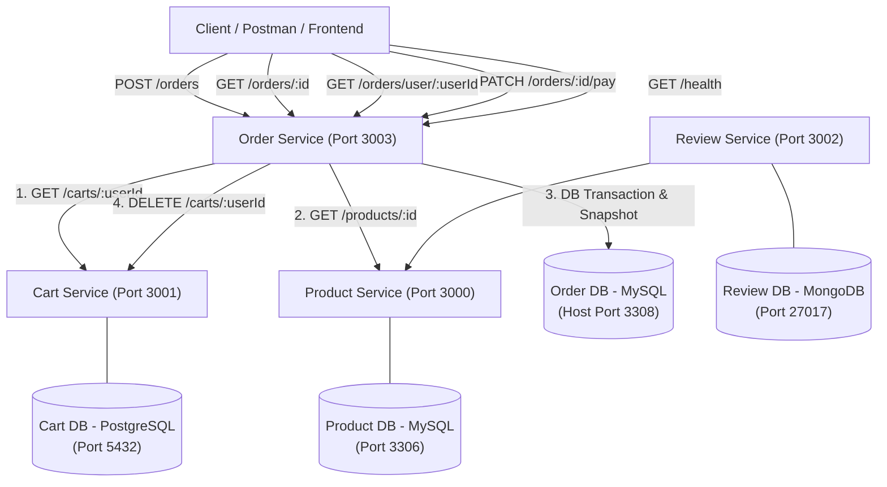

# E-Commerce Microservices: Order Service Ecosystem

Repositori ini berisi implementasi ekosistem microservices e-commerce dengan penambahan **Order Service** berbasis Laravel & MySQL sebagai penyelesaian Ujian Tengah Semester (Take Home) Microservices di Politeknik Negeri Padang.

---

## 1. Arsitektur Sistem

Ekosistem terdiri dari 4 microservices independen dengan database masing-masing (*Database per Service pattern*):



### Pembagian Lapisan (*Layered Architecture*) di Order Service
Sesuai prinsip *Separation of Concerns*:
1. **Routes (`routes/api.php`)**: Mendaftarkan endpoint REST dan filter format parameter angka (`whereNumber`).
2. **Form Request (`app/Http/Requests/`)**: Validasi payload request (`CreateOrderRequest`, `GetOrdersByUserRequest`) sebelum masuk controller.
3. **Controller (`app/Http/Controllers/OrderController.php`)**: Bertanggung jawab menerima request HTTP, memanggil Service, dan memetakan status response (200, 201, 404, 409, 422, 503, 500). Tidak ada query atau business logic di controller.
4. **Service (`app/Services/OrderService.php`)**: Pusat logika bisnis (orkestrasi checkout, validasi aturan bisnis, kalkulasi harga, DB Transaction atomik). Service terisolasi dari HTTP.
5. **HTTP Clients (`app/Clients/`)**: Mengelola panggilan HTTP REST ke service lain (`CartClient`, `ProductClient`) dengan batas timeout 5 detik dan penanganan error jaringan.
6. **Model Eloquent (`app/Models/`)**: `Order` (`hasMany` `OrderItem`) dan `OrderItem` (`belongsTo` `Order`).

---

## 2. Struktur Repositori

```text
ecommerce-microservices/
├── product-service/      # Service katalog produk (Node.js/Express + MySQL)
├── cart-service/         # Service keranjang belanja (Laravel + PostgreSQL)
├── review-service/       # Service ulasan (Python/Flask + MongoDB)
├── order-service/        # Service manajemen pesanan (Laravel + MySQL) - HASIL UTS
├── docker-compose.yml    # Orkestrasi seluruh container microservices
├── DEMO_SCRIPT.md        # Panduan & naskah presentasi video demo (8-15 menit)
└── README.md             # Dokumentasi arsitektur dan sistem
```

---

## 3. Langkah Menjalankan Sistem

Seluruh sistem dirancang agar dapat langsung berjalan dari clone baru tanpa konfigurasi manual:

### Prasyarat
- Docker Desktop aktif (mendukung Docker Compose v2).

### Menjalankan Container
Buka terminal di root repositori dan jalankan:
```bash
docker compose up --build
```

Setelah proses build selesai, seluruh service dan database akan aktif:
- **Product Service:** `http://localhost:3000`
- **Cart Service:** `http://localhost:3001`
- **Review Service:** `http://localhost:3002`
- **Order Service:** `http://localhost:3003`

Database Order Service otomatis melakukan migrasi skema tabel saat container dinaikkan (`php artisan migrate --force`).

---

## 4. Daftar Endpoint API (Order Service)

Base URL: `http://localhost:3003`

### 1. Health Check
- **Method:** `GET`
- **Endpoint:** `/health`
- **Response Sukses (200 OK):**
```json
{
  "status": "ok",
  "service": "order-service"
}
```

---

### 2. Checkout (Membuat Pesanan dari Keranjang)
- **Method:** `POST`
- **Endpoint:** `/orders`
- **Request Body:**
```json
{
  "user_id": 7
}
```
- **Response Sukses (201 Created):**
```json
{
  "message": "Pesanan berhasil dibuat",
  "data": {
    "id": 1,
    "user_id": 7,
    "status": "PENDING",
    "total_amount": 1050000,
    "items": [
      {
        "product_id": 1,
        "product_name": "Keyboard Mekanikal",
        "unit_price": 450000,
        "quantity": 2,
        "subtotal": 900000
      }
    ],
    "created_at": "2026-10-29T10:00:00+00:00",
    "updated_at": "2026-10-29T10:00:00+00:00"
  }
}
```
- **Response Gagal:**
  - **422 Unprocessable Content** (Body tidak valid / `user_id` kosong):
    ```json
    {
      "message": "Data yang dikirim tidak valid",
      "errors": {
        "user_id": ["Field user_id wajib diisi"]
      }
    }
    ```
  - **409 Conflict** (Keranjang kosong):
    ```json
    {
      "message": "Keranjang belanja kosong"
    }
    ```
  - **409 Conflict** (Stok tidak mencukupi):
    ```json
    {
      "message": "Stok Monitor 24 Inch tidak mencukupi: diminta 11, tersedia 10"
    }
    ```
  - **503 Service Unavailable** (Service produk/keranjang mati atau timeout):
    ```json
    {
      "message": "Product service tidak dapat dihubungi, coba lagi nanti"
    }
    ```

---

### 3. Detail Satu Pesanan
- **Method:** `GET`
- **Endpoint:** `/orders/{id}`
- **Response Sukses (200 OK):**
```json
{
  "message": "Berhasil mengambil pesanan",
  "data": {
    "id": 1,
    "user_id": 7,
    "status": "PENDING",
    "total_amount": 1050000,
    "items": [
      {
        "product_id": 1,
        "product_name": "Keyboard Mekanikal",
        "unit_price": 450000,
        "quantity": 2,
        "subtotal": 900000
      }
    ],
    "created_at": "2026-10-29T10:00:00+00:00",
    "updated_at": "2026-10-29T10:00:00+00:00"
  }
}
```
- **Response Gagal (404 Not Found):**
```json
{
  "message": "Pesanan dengan id 99 tidak ditemukan"
}
```

---

### 4. Daftar Pesanan Milik User
- **Method:** `GET`
- **Endpoint:** `/orders/user/{userId}?status=PENDING`
  - Query parameter `?status=` bersifat opsional (hanya menerima `PENDING` atau `PAID`).
- **Response Sukses (200 OK):**
```json
{
  "message": "Berhasil mengambil daftar pesanan",
  "data": [
    {
      "id": 1,
      "user_id": 7,
      "status": "PENDING",
      "total_amount": 1050000,
      "items": [...]
    }
  ]
}
```
- **Response Gagal (422 Unprocessable Content):**
```json
{
  "message": "Data yang dikirim tidak valid",
  "errors": {
    "status": ["Status harus PENDING atau PAID"]
  }
}
```

---

### 5. Simulasi Pembayaran Pesanan
- **Method:** `PATCH`
- **Endpoint:** `/orders/{id}/pay`
- **Response Sukses (200 OK):**
```json
{
  "message": "Pesanan berhasil dibayar",
  "data": {
    "id": 1,
    "user_id": 7,
    "status": "PAID",
    "total_amount": 1050000,
    "items": [...]
  }
}
```
- **Response Gagal (409 Conflict - Sudah Dibayar):**
```json
{
  "message": "Pesanan berstatus PAID, hanya pesanan PENDING yang dapat dibayar"
}
```

---

## 5. Daftar Environment Variables

### Order Service (`order-service/.env` & `docker-compose.yml`)
| Variable | Nilai Default | Penjelasan |
| :--- | :--- | :--- |
| `APP_NAME` | `order-service` | Identitas nama aplikasi |
| `APP_ENV` | `local` | Environment aplikasi |
| `APP_DEBUG` | `true` | Mode debug (detail teknis pada 500/503) |
| `APP_URL` | `http://localhost:3003` | URL publik service |
| `DB_CONNECTION` | `mysql` | Driver database |
| `DB_HOST` | `order-db` | Host container database order |
| `DB_PORT` | `3306` *(Host: `3308`)* | Port MySQL database order |
| `DB_DATABASE` | `orderdb` | Nama database |
| `DB_USERNAME` | `root` | Username database |
| `DB_PASSWORD` | `rootpassword` | Password database |
| `PRODUCT_SERVICE_URL` | `http://product-service:3000` | URL internal container Product Service |
| `CART_SERVICE_URL` | `http://cart-service:3001` | URL internal container Cart Service |
| `PRODUCT_SERVICE_TIMEOUT`| `5` | Batas timeout HTTP client (detik) |
| `CART_SERVICE_TIMEOUT` | `5` | Batas timeout HTTP client (detik) |

---

## 6. Keputusan Desain & Keterbatasan

### Keputusan Desain
1. **Snapshot Harga & Nama Produk:** Nama dan harga produk disalin secara fisik ke tabel `order_items` pada saat transaksi terjadi. Hal ini menjamin integritas riwayat finansial pembeli, meskipun harga di katalog `product-service` berubah sewaktu-waktu.
2. **Database Transaction (`DB::transaction`):** Penyimpanan record ke tabel `orders` dan snapshot ke `order_items` dibungkus dalam transaksi atomik. Jika salah satu operasi database gagal, seluruh perubahan di-rollback secara otomatis.
3. **Graceful Degradation (Kegagalan Mengosongkan Keranjang):** Jika pesanan telah berhasil dicatat ke database namun panggilan pengosongan keranjang (`DELETE /carts/{userId}`) mengalami kegagalan/timeout, pesanan **tidak dibatalkan** (tetap return 201 Created). Kegagalan ini dicatat di log sistem sebagai warning untuk rekonsiliasi data.
4. **Isolasi Database & Port Host:** Sesuai ketentuan, database MySQL order menggunakan container mandiri dan diekspos ke host di port `3308` sehingga tidak berkonflik dengan database katalog produk yang berjalan di port `3306`.

### Keterbatasan Sistem Saat Ini
1. **Komunikasi Synchronous REST:** Pemanggilan antar service (Order $\rightarrow$ Cart dan Order $\rightarrow$ Product) masih menggunakan HTTP sinkron dengan timeout. Jika salah satu service mati, proses checkout akan tertahan hingga timeout (5s) dan gagal. Pada sistem produksi berskala besar (*high-throughput*), arsitektur lebih ideal menggunakan *Event-Driven Architecture* (Message Broker seperti RabbitMQ / Apache Kafka) dengan pola SAGA.
2. **Pengecekan Stok Non-Atomic antar Service:** Pada `product-service` saat ini, stok produk hanya diperiksa (*read-only*) tanpa dilakukan reservasi atau pengurangan stok secara atomik (*distributed locking*).
