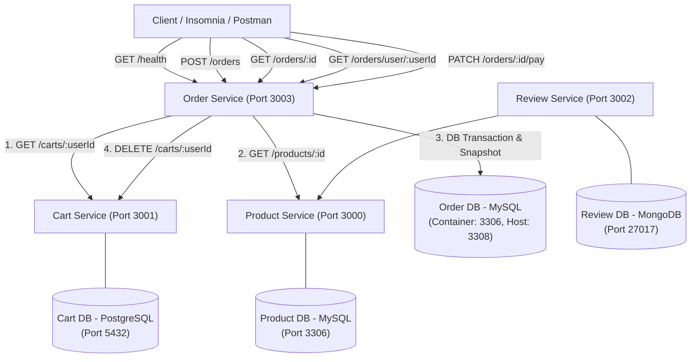

# E-Commerce Microservices: Membangun Order Service

Repositori ini berisi implementasi ekosistem microservices e-commerce dengan penambahan **Order Service** berbasis Laravel & MySQL sebagai penyelesaian Ujian Tengah Semester (Take Home) Mata Kuliah Microservices di Program Studi Sistem Informasi, Politeknik Negeri Padang.

---

## 1. Deskripsi Arsitektur Sistem

Ekosistem terdiri dari 4 microservices independen dengan database masing-masing (*Database per Service pattern*):



### Pembagian Lapisan (*Layered Architecture*) di Order Service
Sesuai ketentuan teknis soal UTS, arsitektur `order-service` memisahkan tanggung jawab kode secara ketat (*Separation of Concerns*):
1. **Routes (`routes/api.php`)**: Mendaftarkan rute REST API dan membatasi tipe parameter path hanya angka (`whereNumber`).
2. **Form Request (`app/Http/Requests/`)**:
   - `CreateOrderRequest`: Validasi body checkout (`user_id` wajib dan integer, return 422 jika tidak valid).
   - `GetOrdersByUserRequest`: Validasi query parameter `?status=` (hanya menerima `PENDING` atau `PAID`, return 422 jika di luar itu).
3. **Controller (`app/Http/Controllers/OrderController.php`)**: Menerima request HTTP, memanggil lapisan service, dan memetakan respon status HTTP (200, 201, 404, 409, 422, 503, 500). Controller tidak mengandung aturan bisnis atau query langsung ke database.
4. **Service (`app/Services/OrderService.php`)**: Menangani seluruh logika bisnis (orkestrasi checkout, validasi aturan bisnis, kalkulasi harga, DB Transaction atomik). Lapisan service terisolasi murni dan tidak bergantung pada objek HTTP Request/Response.
5. **HTTP Clients (`app/Clients/`)**: Mengelola komunikasi keluar via REST:
   - `ProductClient`: Memanggil `GET /products/{id}`.
   - `CartClient`: Memanggil `GET /carts/{userId}` dan `DELETE /carts/{userId}`.
   - Dilengkapi batas `timeout` maksimal 5 detik dan penanganan error jaringan (`ServiceUnavailableException` $\rightarrow$ respon 503).
6. **Model Eloquent (`app/Models/`)**:
   - `Order`: Mewakili tabel `orders` dengan relasi `hasMany(OrderItem::class)` dan query scope `scopeForUser()`.
   - `OrderItem`: Mewakili tabel `order_items` dengan relasi `belongsTo(Order::class)`.

---

## 2. Struktur Repositori

```text
Microservice/
├── product-service/      # Service katalog produk (Node.js/Express + MySQL) - hasil kelas
├── cart-service/         # Service keranjang belanja (Laravel + PostgreSQL) - hasil kelas
├── review-service/       # Service ulasan (Python/Flask + MongoDB) - hasil kelas
├── order-service/        # Service manajemen pesanan (Laravel + MySQL) - HASIL UTS
│   ├── app/
│   │   ├── Clients/      # ProductClient & CartClient (HTTP Client layer)
│   │   ├── Exceptions/   # Custom Exceptions (404, 409, 503)
│   │   ├── Http/
│   │   │   ├── Controllers/  # OrderController
│   │   │   └── Requests/     # CreateOrderRequest & GetOrdersByUserRequest
│   │   ├── Models/       # Eloquent Models: Order & OrderItem
│   │   └── Services/     # OrderService (Core business logic)
│   ├── database/
│   │   └── migrations/   # Migrations untuk tabel orders dan order_items
│   ├── routes/           # api.php
│   ├── Dockerfile        # Container image definition untuk order-service
│   └── .env.example      # Template konfigurasi environment
├── docker-compose.yml    # Orkestrasi seluruh container microservices
├── DEMO_SCRIPT.md        # Panduan & skrip presentasi video demo UTS (8-15 menit)
└── README.md             # Dokumentasi arsitektur dan sistem
```

---

## 3. Langkah Menjalankan Sistem

Seluruh sistem diorkestrasi menggunakan Docker Compose sehingga dapat langsung dijalankan dari hasil clone baru:

### Prasyarat
- Docker Desktop aktif (mendukung Docker Compose v2).

### Menjalankan Container
Buka terminal di root repositori dan jalankan perintah:
```bash
docker compose up --build
```
*(Atau gunakan opsi `-d` jika ingin berjalan di latar belakang: `docker compose up -d --build`)*

Setelah container siap:
- **Product Service:** `http://localhost:3000`
- **Cart Service:** `http://localhost:3001`
- **Review Service:** `http://localhost:3002`
- **Order Service:** `http://localhost:3003`

Skema database `order-service` otomatis diinisialisasi melalui migrasi saat container pertama kali menyala (`php artisan migrate --force`).

---

## 4. Daftar Endpoint API (Order Service)

Base URL: `http://localhost:3003`

| Method | Endpoint | Fungsi | Status Sukses | Status Gagal & Kondisi |
| :--- | :--- | :--- | :---: | :--- |
| `GET` | `/health` | Mengecek service hidup | 200 | Tidak ada |
| `POST` | `/orders` | Checkout pesanan dari isi keranjang | 201 | **422**: Body tidak valid<br>**409**: Keranjang kosong / produk tidak ada / stok kurang<br>**503**: Service lain mati/timeout<br>**500**: Error tak terduga |
| `GET` | `/orders/{id}` | Detail satu pesanan beserta item-itemnya | 200 | **404**: Pesanan tidak ditemukan / ID bukan angka |
| `GET` | `/orders/user/{userId}` | Daftar pesanan satu user (terbaru di atas, filter opsional `?status=`) | 200 | **422**: Nilai status tidak valid (bukan PENDING/PAID) |
| `PATCH` | `/orders/{id}/pay` | Bayar pesanan (simulasi: PENDING $\rightarrow$ PAID) | 200 | **404**: Pesanan tidak ditemukan<br>**409**: Status bukan PENDING (sudah PAID) |

---

### Contoh Request & Response

#### 1. GET /health
- **Request:** Tanpa body
- **Response Sukses (200 OK):**
```json
{
  "status": "ok",
  "service": "order-service"
}
```

---

#### 2. POST /orders (Checkout)
- **Request Body:**
```json
{
  "user_id": 7
}
```
- **Response Sukses (201 Created):**
```json
{
  "message": "Pesanan berhasil dibuat",
  "data": {
    "id": 1,
    "user_id": 7,
    "status": "PENDING",
    "total_amount": 1050000,
    "items": [
      {
        "product_id": 1,
        "product_name": "Keyboard Mekanikal",
        "unit_price": 450000,
        "quantity": 2,
        "subtotal": 900000
      },
      {
        "product_id": 2,
        "product_name": "Mouse Wireless",
        "unit_price": 150000,
        "quantity": 1,
        "subtotal": 150000
      }
    ],
    "created_at": "2026-10-31T10:00:00+00:00",
    "updated_at": "2026-10-31T10:00:00+00:00"
  }
}
```
- **Response Gagal — Body Tidak Valid (422):**
```json
{
  "message": "Data yang dikirim tidak valid",
  "errors": {
    "user_id": [
      "Field user_id wajib diisi"
    ]
  }
}
```
- **Response Gagal — Stok Tidak Cukup (409):**
```json
{
  "message": "Stok Monitor 24 Inch tidak mencukupi: diminta 11, tersedia 10"
}
```
- **Response Gagal — Keranjang Kosong (409):**
```json
{
  "message": "Keranjang belanja kosong"
}
```
- **Response Gagal — Service Lain Mati / Timeout (503):**
```json
{
  "message": "Product service tidak dapat dihubungi, coba lagi nanti"
}
```

---

#### 3. GET /orders/{id}
- **Request:** `GET /orders/1` (tanpa body)
- **Response Sukses (200 OK):**
```json
{
  "message": "Berhasil mengambil pesanan",
  "data": {
    "id": 1,
    "user_id": 7,
    "status": "PAID",
    "total_amount": 1050000,
    "items": [
      {
        "product_id": 1,
        "product_name": "Keyboard Mekanikal",
        "unit_price": 450000,
        "quantity": 2,
        "subtotal": 900000
      }
    ],
    "created_at": "2026-10-31T10:00:00+00:00",
    "updated_at": "2026-10-31T10:30:00+00:00"
  }
}
```
- **Response Gagal (404 Not Found):**
```json
{
  "message": "Pesanan dengan id 99 tidak ditemukan"
}
```
*(Catatan: Jika id pada path bukan angka, misalnya `/orders/abc`, otomatis mengembalikan 404).*

---

#### 4. GET /orders/user/{userId}
- **Request:** `GET /orders/user/7?status=PENDING`
  - Parameter `?status=` opsional. Nilai yang sah hanya `PENDING` dan `PAID`.
- **Response Sukses (200 OK):**
```json
{
  "message": "Berhasil mengambil daftar pesanan",
  "data": [
    {
      "id": 2,
      "user_id": 7,
      "status": "PENDING",
      "total_amount": 150000,
      "items": [
        {
          "product_id": 2,
          "product_name": "Mouse Wireless",
          "unit_price": 150000,
          "quantity": 1,
          "subtotal": 150000
        }
      ],
      "created_at": "2026-10-31T11:00:00+00:00",
      "updated_at": "2026-10-31T11:00:00+00:00"
    }
  ]
}
```
- **Response Gagal — Filter Status Tidak Valid (422):**
```json
{
  "message": "Data yang dikirim tidak valid",
  "errors": {
    "status": [
      "Status harus PENDING atau PAID"
    ]
  }
}
```

---

#### 5. PATCH /orders/{id}/pay
- **Request:** `PATCH /orders/2/pay` (tanpa body)
- **Response Sukses (200 OK):**
```json
{
  "message": "Pesanan berhasil dibayar",
  "data": {
    "id": 2,
    "user_id": 7,
    "status": "PAID",
    "total_amount": 150000,
    "items": [...],
    "created_at": "2026-10-31T11:00:00+00:00",
    "updated_at": "2026-10-31T11:05:00+00:00"
  }
}
```
- **Response Gagal — Status Bukan PENDING (409 Conflict):**
```json
{
  "message": "Pesanan berstatus PAID, hanya pesanan PENDING yang dapat dibayar"
}
```

---

## 5. Daftar Environment Variables

### Order Service (`order-service/.env` & `docker-compose.yml`)
| Variable | Nilai Default | Penjelasan |
| :--- | :--- | :--- |
| `APP_NAME` | `order-service` | Nama aplikasi |
| `APP_ENV` | `local` | Environment runtime aplikasi |
| `APP_DEBUG` | `true` | Mode debug (detail teknis hanya muncul saat `true`) |
| `APP_URL` | `http://localhost:3003` | URL dasar service |
| `DB_CONNECTION` | `mysql` | Driver database relasional |
| `DB_HOST` | `order-db` | Nama host container database MySQL milik order-service |
| `DB_PORT` | `3306` *(Host: `3308`)* | Port database MySQL (host port 3308 agar tidak bentrok dengan product-db 3306) |
| `DB_DATABASE` | `orderdb` | Nama database MySQL pesanan |
| `DB_USERNAME` | `root` | Username koneksi database |
| `DB_PASSWORD` | `rootpassword` | Password koneksi database |
| `PRODUCT_SERVICE_URL` | `http://product-service:3000` | URL internal Docker untuk mengakses Product Service |
| `CART_SERVICE_URL` | `http://cart-service:3001` | URL internal Docker untuk mengakses Cart Service |
| `PRODUCT_SERVICE_TIMEOUT`| `5` | Batas timeout HTTP client ke Product Service (maksimal 5 detik) |
| `CART_SERVICE_TIMEOUT` | `5` | Batas timeout HTTP client ke Cart Service (maksimal 5 detik) |

---

## 6. Keputusan Desain & Keterbatasan

### Keputusan Desain
1. **Pola Snapshot Harga & Nama Produk:**
   Nama dan harga produk disalin saat transaksi checkout berlangsung ke tabel `order_items`. Hal ini memastikan bahwa perubahan harga di katalog `product-service` di masa depan tidak akan memengaruhi riwayat nominal pesanan yang telah disepakati oleh pembeli.
2. **Transaksi Database Atomik (`DB::transaction`):**
   Penyimpanan record induk di tabel `orders` dan snapshot rincian item di tabel `order_items` dibungkus dalam satu transaksi database. Apabila terjadi kegagalan di tengah proses, seluruh data dibatalkan (*rollback*) secara otomatis sehingga integritas data tetap konsisten.
3. **Graceful Degradation (Kegagalan Mengosongkan Keranjang):**
   Sesuai aturan soal UTS, apabila pesanan telah berhasil disimpan namun `cart-service` gagal dikosongkan (misal karena jaringan atau timeout), pesanan **tidak boleh dibatalkan**. Order Service tetap mengembalikan respon sukses `201 Created` kepada klien dan mencatat kejadian kegagalan tersebut ke log aplikasi untuk rekonsiliasi.
4. **Isolasi Database & Port Host:**
   `order-service` memiliki database MySQL sendiri di container `order-db`. Port container dipetakan ke port host `3308` untuk mematuhi larangan penggunaan port `3306` yang telah dipakai oleh MySQL milik `product-service`.

### Keterbatasan Solusi Saat Ini
1. **Komunikasi REST Sinkron Antar-Service:**
   Proses checkout masih bergantung pada pemanggilan HTTP sinkron ke `cart-service` dan `product-service`. Jika beban trafik sangat tinggi atau salah satu service mengalami latensi, waktu checkout akan terhambat hingga batas timeout tercapai. Pada sistem skala produksi besar (*production grade*), arsitektur ini lebih ideal menerapkan komunikasi asinkron berbasis *Message Broker* (seperti RabbitMQ atau Apache Kafka) dengan pola SAGA / Event-Driven Architecture.
2. **Pengecekan Stok Bersifat Read-Only (Non-Atomic Reservation):**
   Sesuai batasan lingkup soal UTS, `order-service` hanya memeriksa stok produk tanpa melakukan pengurangan stok di `product-service`. Dalam skenario *high-concurrency real world*, diperlukan mekanisme *distributed lock* atau *stock reservation* agar tidak terjadi kondisi *race condition* (overselling).
